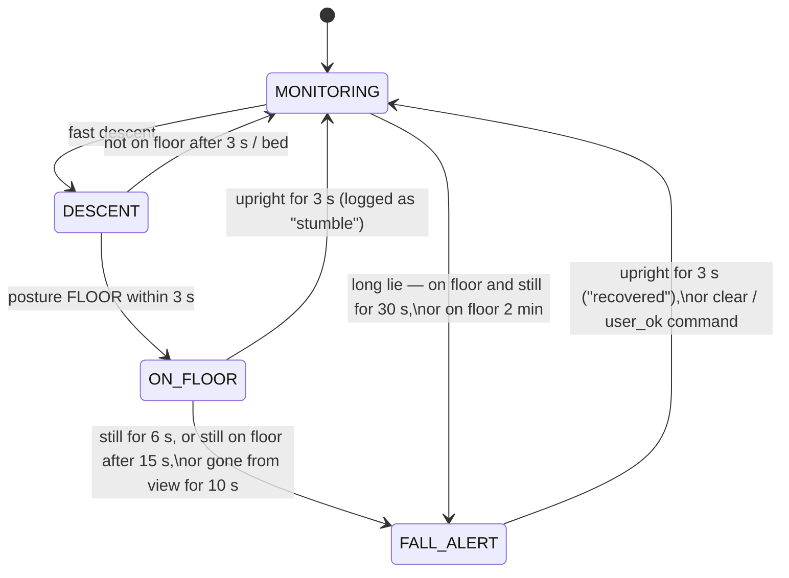

# How the fall detector works

For the report (fall detection section) and the viva. Code: `firmware/piper_fall_detect/fall_algo.h`.

## The idea in one paragraph

A fall is not a posture, it is a **sequence**: the body drops fast, ends up on the floor, and
usually stays there. The first version looked at single frames ("is the box wide and low?"), so
it missed falls that don't look wide from the camera and could be fooled by anything warm. This
version tracks one person, measures their body with image moments, knows where the floor and
the bed are in the room, and only alerts when the whole sequence happens, or when someone has
been lying still on the floor for too long. All timing is in milliseconds, so it behaves the same
at any frame rate.

## Pipeline (every frame, about 4 per second)

```
32×24 frame ──► 1 background ──► 2 blobs ──► 3 body features ──► 4 posture ──► 5 state machine ──► alert
                (per pixel)      (person)    (moments, zones,      (upright,      (descent → floor
                                              motion)               low, floor,     → still; long lie)
                                                                    rest)
```

### 1. Background, per pixel

Each pixel keeps its own background temperature. A pixel is **body** if it is more than
`fgDelta` (1.3 °C) warmer than its own background.

- Empty pixels slowly follow the room (`bgAlpha`), so warming up or cooling down doesn't matter.
- The person's pixels are **never** learned into the background, so someone lying still stays visible.
- Warm things that never move (heater, mug, laptop) are slowly absorbed (`staticAlpha`) and fade out.

*Why:* the first version used one median for the whole frame. That breaks when the person is
close and fills half the image, and it treats every heat source as part of the body.

### 2. Blobs: which warm thing is the person?

Warm pixels are grouped into connected blobs (8-connected flood fill). Small blobs are ignored,
and fragments within `mergeGap` pixels of the person are joined (head and torso can split at 32×24).

The track follows the blob that overlaps where the person was last seen. A blob that doesn't
overlap, or suddenly shrinks to a third of the size, is treated as **a new object**. This is how the
detector avoids "inheriting" a warm seat cushion or patch of floor when someone walks out of view.
Until a track has moved, the largest blob wins, so a radiator seen at boot can't hide a person
who walks in.

### 3. Body features from image moments

From the person's pixels:

| Feature | Meaning |
|---|---|
| centroid (cx, cy) | centre of the body |
| top, bottom, height, width | body extent from the 2nd moments: extent = √12 × std. Much steadier than a bounding box: one noisy pixel or an outstretched arm barely moves it |
| ratio = height / width | tall = upright |
| elongation, angle | main body axis (ceiling mount) |
| floor share | share of body pixels on **floor** zone pixels |
| rest share | share on **bed/sofa** zone pixels |
| motion | mean temperature change on the body between frames **minus** the same on background pixels (sensor noise), smoothed |

### 4. Posture, using the room's zones

Wall mount. The key observation: **a person lying on the floor only covers floor pixels; a
standing person also covers the wall behind them.** This holds whichever way they fall, toward
the camera, away from it, or across it. The bounding-box aspect ratio in the first version only
worked for falls *across* the view.

| Posture | Rule (defaults) |
|---|---|
| REST | ≥ 50% of the body on bed/sofa |
| FLOOR | ≥ 60% on floor and not tall, or ≥ 85% on floor whatever the shape |
| UPRIGHT | height / width ≥ 1.2 |
| LOW | anything else (sitting, bending, crouching) |

Ceiling mount (looking down): standing is a small round blob and lying is a long one, so FLOOR =
long (elongation ≥ 1.8) or much bigger than the person's normal upright size (learned while they
walk about).

A new posture must last 400 ms before it counts, so a single noisy frame can't flip it.

### 5. State machine



**Fast descent** (wall mount). Within the last 1 s, all of these:
- the top of the body moved down ≥ 3 rows **and** ≥ 40% of the body's height;
- the body's height shrank to ≤ 75%;
- the bottom of the body did **not** rise by more than 2 rows. Walking away from the camera
  shrinks the body too, but the feet move *up* the image. In a fall they stay down.

Controlled movements (sitting down, lying down on purpose over 2 s or more) are too slow for this
test. They can still reach the floor, but then only the long-lie path applies.
Ceiling mount: the blob's area grows by 1.6× within 1 s.

**Confirmation after a descent.** Being on the floor and still for 6 s gives a fast alert. Being on
the floor for 15 s alerts **even if moving**: someone struggling to get up has still fallen.

**Long lie (no descent needed).** Catches slow slides down a wall or chair, and falls out of bed.
To stop pets and warm objects triggering it, the tracked object must have **moved** and must have
**looked like a person** at some point (stood upright, or lay in bed).

**The alert is latched.** No timer clears it. It ends only when the person is seen upright for 3 s
(`recovered` is sent, so the caregiver knows they got up), or by a command: `clear` from a
caregiver or `user_ok` after PIPER asked and the person said they're fine. After `user_ok`, if
the person stays on the floor and still, long-lie raises a new alert 30 s later.

## Why not just make the thresholds stricter?

Every threshold in the first version had to do two jobs at once, "detect" and "don't
false-alarm", on one frame. Splitting the decision into phases lets each test be loose on its
own (a quick bend passes the descent test, a deliberate floor sit passes the floor test) while
the *combination* stays specific. The stillness check and PIPER asking "are you okay?" handle the
remaining grey zone, instead of hiding it in a threshold.

## Results on synthetic scenes (logic check only)

29 drawn scenes: a warm ellipse on a noisy room, 4 and 8 fps. Full table: `synthetic_results.md`.

| | Falls detected | Normal scenes without alert | Median latency |
|---|---|---|---|
| This algorithm | 11 / 11 | 18 / 18 | 9.2 s |
| Original algorithm | 3 / 11 | 18 / 18 | 4.2 s |

The original missed falls toward and away from the camera, a struggling person, the slow slide,
the fall out of bed, a fall next to a radiator, and the ceiling-mount fall (it was designed for
wall mount only).

**Be clear about what this shows.** These scenes test that the logic does what it was designed
to do, and they caught several real bugs during development (see below). They do **not**
measure real-world accuracy: real bodies, clothing, rooms and sensor noise are messier than an
ellipse. Real numbers come only from recordings, using `TEST_PROTOCOL.md`.

**The trade-off.** The new version alerts later (about 9 s after a fall vs about 4 s) because it
waits for stillness. For a person with dementia, a few seconds matter less than an alarm system
people learn to ignore. `stillConfirmMs` sets this trade-off and can be swept on real recordings.

## Bugs the synthetic tests found during development

These are good viva material. Bugs 1, 2 and 4 each have a test that fails on the code before the fix.

1. **Sensor noise made a heater "move".** Movement was summed frame by frame, so noise
   jitter added up until a floor heater counted as a person who had walked in, and then it raised
   a long-lie alert. Fix: measure *net* displacement from where the track started.
2. **Lying down on purpose over 2 s looked like a fall.** The descent window was 1.5 s. Real
   falls take under about 1 s, so the window became 1 s and the drop must be ≥ 40% of body height.
3. **Smoothing depended on frame rate.** Per-frame smoothing made 8 fps react about 1 s faster
   than 4 fps. Fix: time-constant smoothing. The two now agree within 0.75 s on the five scenes generated at both rates, and a test keeps
   them within 1.5 s.
4. **A cat lying on the floor triggered long lie**, and **a warm patch left where someone sat**
   inherited the person's track. Fix: identity by overlap and size, plus "must have looked like
   a person" for long lie. Removing these guards makes both scenes alert again.

## Known limitations

- **Two people close together** can merge into one blob. The detector assumes one person in view.
- **Partial occlusion** behind furniture: a fall behind a bed or sofa may only be seen as the
  person disappearing (an alert after 10 s if this follows a descent; otherwise missed).
- **Boot with someone already lying perfectly still** (e.g. after a power cut at night): they
  fade into the background within a minute or two until they move. Start the node with the room
  empty or the person moving.
- **Pets that stand upright on the bed or sofa** could count as "person-like".
- **Thresholds come from synthetic scenes and the first sketch's measurements.** Re-tune on
  your recordings.
- **Single sensor, single room**, and only as good as the zone map. Move the sensor → repaint the zones.
- **MQTT publishing is QoS 0** (a PubSubClient limit), so status is republished every 10 s
  during an alert and is retained, so a missed packet is recovered.

## Parameters

All in `struct Config` in `fall_algo.h`. Override per device in `applyTuning()` in `config.h`;
try values on recordings first with `evaluate.py --set` or `--sweep`.

| Group | Parameter | Default | What it does |
|---|---|---|---|
| Body | `fgDelta` | 1.3 °C | warmer than background by this = body |
| | `minBlobPixels` | 6 | smaller blobs ignored |
| | `mergeGap` | 2 px | join body fragments this close |
| | `bgAlpha` / `staticAlpha` | 0.05 / 0.01 | background learning: empty pixels / still warm objects |
| | `moveToTrack` | 2 px | net movement before a track counts as moved |
| Posture | `floorFracMin` / `floorFracSure` | 0.60 / 0.85 | share on floor = on floor |
| | `restFracMin` | 0.50 | share on bed/sofa = resting |
| | `uprightRatio` | 1.20 | height / width = upright |
| Descent | `descentWindowMs` | 1000 | must happen within |
| | `descentMinRows` / `descentMinFrac` | 3 / 0.40 | top of body drop: rows / share of height |
| | `descentShrink` | 0.75 | height must shrink to ≤ this |
| | `bottomRiseMax` | 2 rows | feet may rise at most this (walking away) |
| Stillness | `stillMotion` | 0.15 °C | below this (after noise) = still |
| Timers | `impactWindowMs` | 3000 | descent → floor within |
| | `stillConfirmMs` | 6000 | on floor + still → alert |
| | `floorConfirmMs` | 15000 | on floor after descent → alert even if moving |
| | `longLieMs` | 30000 | on floor + still, no descent → alert |
| | `floorMaxMs` | 120000 | on floor at all → alert (0 = off) |
| | `recoverMs` | 3000 | upright → alert ends |
| | `lostConfirmMs` | 10000 | vanished after landing on floor → alert |
| Ceiling | `ceilAreaGrowth`, `ceilLyingElong`, `ceilLyingArea` | 1.6, 1.8, 1.8 | top-down descent and lying tests |
